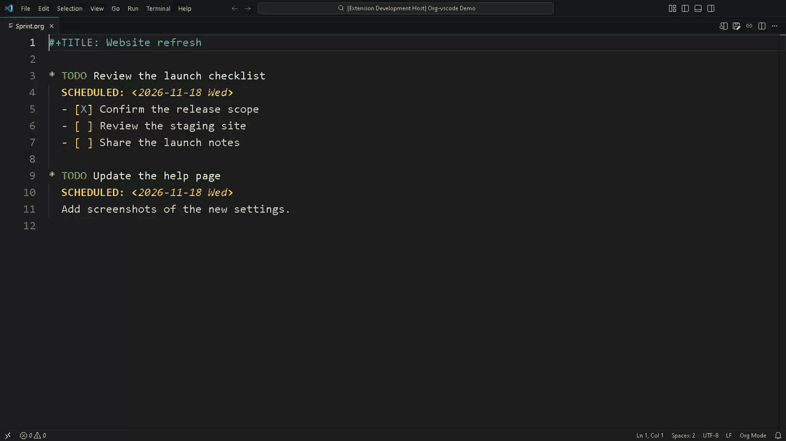
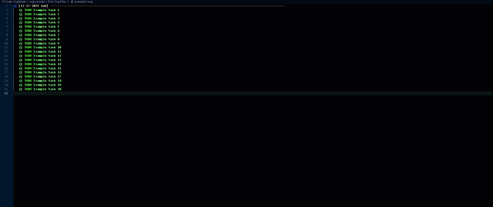

	

  

> A fast, keyboard-driven Org Mode–style task manager built for Visual Studio Code.
> Inspired by Emacs Org Mode

Org-vscode brings Emacs Org Mode workflows to VS Code. See the [roadmap](docs/roadmap.md) for planned features and compatibility work.

## 🎬 Demo

Check off an item and change a task’s TODO state from Agenda View. Both changes appear immediately in the `.org` source file.

[Download the full-resolution demo (WebM)](https://raw.githubusercontent.com/realDestroyer/org-vscode/master/Images/agenda-demo.webm) · [Browse feature guides](docs/README.md#browse-by-workflow)

---

## Summary

Org-vscode helps you manage tasks, notes, and projects in plain text `.org` files — with a keyboard-first workflow, clickable Agenda/Calendar views, tags, checklists, and multi-line selection editing.

## Feature Highlights

- Selection-aware editing across multiple lines (status, schedule, deadline, tags, indentation)
- Optional auto-indent of body/planning lines on Enter (`Org-vscode.autoIndentNonHeaderText` + `Org-vscode.bodyIndentation`)
- Optional scheduled-date suffix on task headlines via decorations (`Org-vscode.decorateHeadingScheduledDates`)
- Optional deadline-date suffix on task headlines via decorations (`Org-vscode.decorateHeadingDeadlineDates`)
- v2 Org-mode alignment: `:TAGS:` at end of headline, planning lines under headings, `CLOSED:` stamp
- Align Schedules behavior is configurable (and won’t align `:PROPERTIES:` drawers)
- Configurable TODO workflow states (`Org-vscode.workflowStates`) with per-state semantics (done-like, CLOSED stamping, optional transition-note prompts, carryover/forward-trigger, agenda visibility)
- Configurable Org priority cycling (`Org-vscode.priorityValues`) for star and Unicode headings, with forward and backward Command Palette commands
- Optional private workspace heading index, declarative `#+BEGIN_QUERY` preview blocks, and saved Explorer perspectives (`Org-vscode.workspaceIndex.enabled`)
- Repeating tasks via Org repeaters (`+`, `++`, `.+`) with optional `REPEAT_TO_STATE` reopen behavior
- Optional LOGBOOK drawer logging for completion history (`Org-vscode.logIntoDrawer`, `Org-vscode.logDrawerName`)
- Faster Agenda scanning on large `.org` files (performance improvements for big task files)
- Agenda View + Tagged Agenda View (Emacs-style match strings) + Calendar View (click task text to jump to the exact source line)
	- Agenda View includes scheduled tasks, deadline-only tasks, and an optional (default-on) `[UNDATED]` section for tasks with no dates
	- Agenda View includes a **Closed** tab (recently completed tasks grouped by completion date) and a **Range** filter (All / This week / This month / This year)
- Checklists with hierarchical parent/child checkbox states
- Workflow keywords on checkbox items (`- [ ] TODO ...`) that rotate in place with `Ctrl + →` / `Ctrl + ←`
- Org-mode statistics cookies: `[/]` (fraction) and `[%]` (percent)
- Subtree completion stats on headings (TODO subtree completion + checkbox completion)
- Emphasis rendering for `*bold*`, `/italic/`, `_underline_`, `+strike+`
- Org-mode syntax highlighting for common constructs: lists, code blocks, links, priorities (`[#A]`), property drawers, directives (`#+...`), and basic math fragments
- Execute `#+BEGIN_SRC` code blocks (Org-babel-style MVP) and insert/update `#+RESULTS:` immediately (CodeLens + right-click + command palette)
- Live Preview (HTML) with editor → preview scroll sync, plus standalone HTML export
- `.org_archive` files use the full Org language mode, preview, navigation, and command set
- Math symbol decorations (experimental): renders common LaTeX commands (e.g. `\alpha`) as Unicode glyphs while editing
- Smart navigation helpers: Document Outline (headings) + clickable Org links (including `[[*heading]]`, `[[id:...]]`, `[[#target]]`, `file:`, `http(s)`, `mailto:`)
- Workspace heading link insertion with automatic stable IDs (`Ctrl + Alt + L` / `Cmd + Alt + L`)
- Subtree promotion/demotion and safe same-file or cross-file refile from the Command Palette
- Org-style heading visibility cycling with `Tab` and document-wide cycling with `Shift + Tab`
- Bindable context actions and structure-aware `Ctrl + Enter` insertion
- Optional configurable action links above Org headings
- Org link auto-completion inside `[[...]]` (including workspace-wide `id:` suggestions)
- Property drawer helpers: set/get/delete properties (with inheritance) + ID helpers (get-or-create, set/replace)
- Org table generator (command + snippets)
- Reports/tools: Export Current Tasks, Export Yearly Summary, Executive Report, Year-In-Review Dashboard
- Customization: Syntax Color Customizer (colors + Workflow States editor) + settings for heading markers / indentation / decorations
- Custom workflow states get their own syntax color options in the Syntax Color Customizer, applied immediately after saving
- Commands: Sort Headings by Scheduled Date (`Org-vscode.sortClosedTasksToTop` optional)
- **External Capture & Link API** (opt-in, off by default): other VS Code extensions can register custom org link schemes (e.g. `[[msgid:abc@host]]`) and push structured TODO entries into your inbox after a per-extension consent prompt. There's also a built-in **Org-vscode: Capture TODO into Inbox** palette command for quick personal capture. See [docs/external-api.md](docs/external-api.md), the runnable [examples/external-consumer/](examples/external-consumer/README.md), and [SECURITY.md](SECURITY.md).

Try the [walkthrough Org file](examples/demo-walkthrough.org) or use the [documentation index](docs/README.md) to find a specific workflow.

## 🚀 Quick Start (Emacs-inspired)

Most workflows are designed to feel familiar if you use Emacs Org Mode — keyboard-first, selection-aware edits, and “structure-first” navigation.

1. Install **org-vscode** from the [Visual Studio Marketplace](https://marketplace.visualstudio.com/items?itemName=realDestroyer.org-vscode) or [Open VSX](https://open-vsx.org/extension/realDestroyer/org-vscode).
2. Open an existing `.org` file, create one, or try the [example Org file](examples/demo-walkthrough.org).
3. Open the Command Palette and search for `Org-vscode` to find commands. Common shortcuts are listed below.

- Use `Ctrl+Shift+O` to jump to headings (Outline is powered by the Org heading structure).
- Use `Ctrl+Click` (Windows/Linux) / `Cmd+Click` (Mac) on `[[links]]` to follow them.
- Type `[[` (or `[[id:`) to trigger Org link completion.

## 🔑 Keyboard Shortcuts

Most editing shortcuts support multi-line selection: highlight multiple task lines (or use multi-cursor) and run the command to apply it to every selected line.

| Shortcut             | Description                                            |
| -------------------- | ------------------------------------------------------ |
| `Ctrl + →`           | Cycle TODO keyword forward (selection-aware)           |
| `Ctrl + ←`           | Cycle TODO keyword backward (selection-aware)          |
| *(Command Palette)*  | Org-vscode: Set TODO State...                          |
| *(Command Palette)*  | Cycle Priority / Cycle Priority Backward               |
| `Shift + Alt + ↑`    | Move task block up (keeps children/subtree)            |
| `Shift + Alt + ↓`    | Move task block down (keeps children/subtree)          |
| `Alt + →`            | Increase heading level (selection-aware)               |
| `Alt + ←`            | Decrease heading level (selection-aware)               |
| `Alt + Enter`        | Smart insert new element (Org Meta-Return style)       |
| `Tab`                | Cycle heading subtree visibility                       |
| `Shift + Tab`        | Cycle document-wide heading visibility                 |
| *(user binding)*     | Run `Org-vscode: Execute Context Action` at the cursor   |
| `Ctrl + Enter`       | Insert matching structure after the current item        |
| `Ctrl + Shift + [`   | Fold section                                           |
| `Ctrl + Shift + ]`   | Unfold section                                         |
| `Ctrl + Alt + S`     | Schedule a task (selection-aware)                      |
| `Ctrl + Alt + D`     | Add deadline to task (selection-aware)                 |
| `Ctrl + Alt + X`     | Toggle checkbox item (selection-aware)                 |
| `Ctrl + Alt + K`     | Add, change, or remove a statistics cookie             |
| `Alt + Shift + →`    | Smart date forward (selection-aware)                   |
| `Alt + Shift + ←`    | Smart date backward (selection-aware)                  |
| `Ctrl + Shift + →`   | Deadline date forward (selection-aware)                |
| `Ctrl + Shift + ←`   | Deadline date backward (selection-aware)               |
| `Alt + Shift + A`    | Align all scheduled timestamps                         |
| `Alt + Shift + S`    | Add separator line (hyphens)                           |
| `Ctrl + Shift + T`   | Add tag to task (selection-aware)                      |
| *(Command Palette)*  | Org-vscode: Convert Dates in Current File              |
| `Ctrl + Shift + G`   | Open the Tagged Agenda View                            |
| `Ctrl + Shift + C`   | Open the Calendar View                                 |
| `Ctrl + Alt + P`     | Open Live Preview to the side                          |
| `Ctrl + Alt + L`     | Insert link to a workspace heading                     |
| *(Command Palette)*  | Promote, demote, or refile the current subtree         |
| *(Command Palette)*  | Export Current File to HTML                            |
| `Ctrl + Shift + E`   | Export all active (non-DONE) tasks to CurrentTasks.org |
| `Ctrl + Alt + M`     | Show popup message (GitHub link)                       |

Src block execution currently has no default keybinding (use CodeLens, right-click, or Command Palette: **Org-vscode: Execute Src Block**).

---

## 🧩 Snippets

| Prefix       | Description                     |
| ------------ | ------------------------------- |
| `/header`    | Create a section header block   |
| `/todo`      | New TODO task (scheduled today) |
| `/checklist` | Checklist block with boxes      |
| `/meeting`   | Daily log or meeting notes      |
| `/tagged`    | Tagged task template            |
| `/deadline`  | Task with SCHEDULED + DEADLINE  |
| `/dl`        | Add DEADLINE to existing task   |
| `/table2`    | Quick 2x2 org-style table       |
| `/table3`    | Quick 3x3 org-style table       |
| `/section`   | Labeled section block           |
| `/template`  | Full task template with tags    |
| `/day`       | Day heading with date & separator |

---

## ✅ Multi-line selection editing

---

## More Details

- [Browse by workflow](docs/README.md#browse-by-workflow) to find a feature, from scheduling and navigation to reporting.
- Read the [full how-to guide](docs/howto.md), [changelog](docs/CHANGELOG.md), or [roadmap](docs/roadmap.md).

---

## 🐞 Issues and Contributions

If you run into a bug or have a feature request, please open an [issue](https://github.com/realdestroyer/org-vscode/issues).

Pull requests are welcome. See the [contributor guide](docs/CONTRIBUTING.md) for setup, testing, and the pull request workflow.

---

## 👨‍💻 Author

* Maintained by [@realDestroyer](https://github.com/realDestroyer)
* Originally forked from a legacy project by Bobby Boyd — now significantly overhauled with countless new features created from scratch.

---

## 📄 License

MIT License — see [LICENSE.md](LICENSE.md) for full details.
